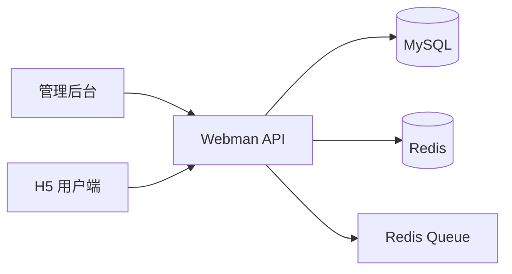
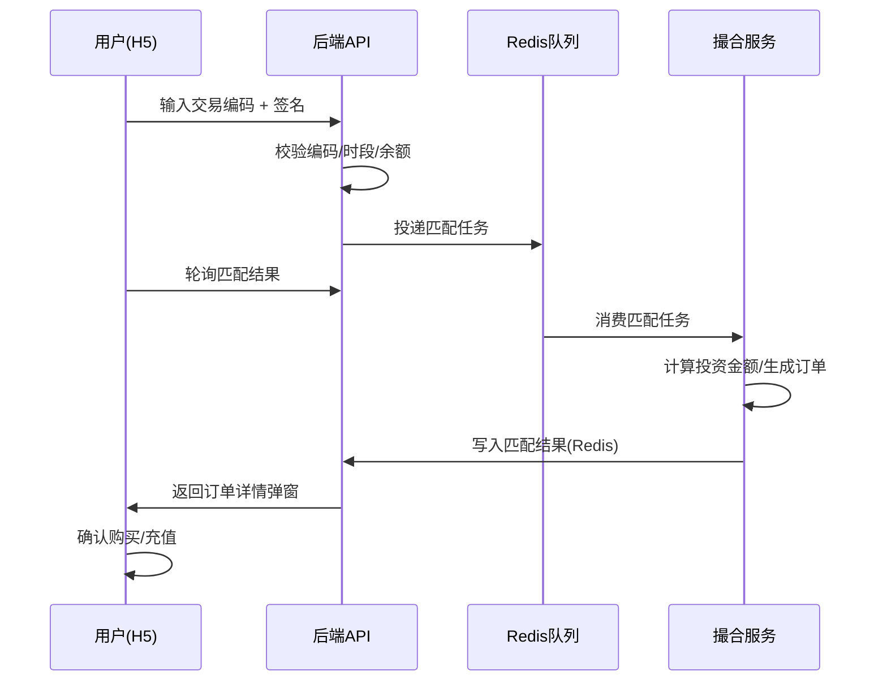
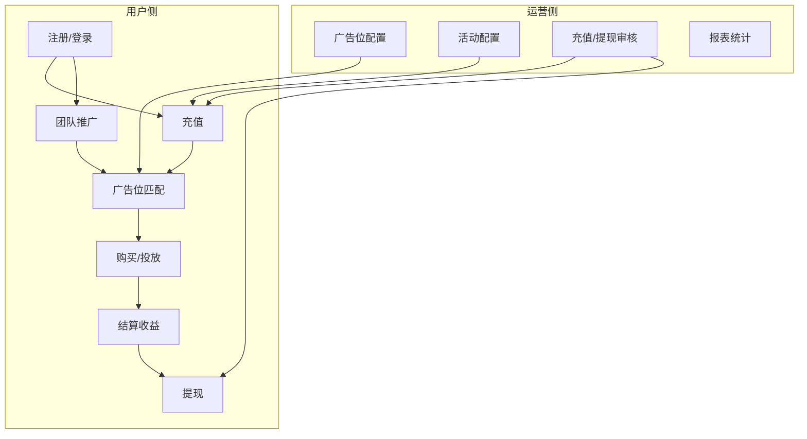

# 广告刷单系统 — 业务功能文档

> 版本：2026-07-10  
> 适用对象：产品、运营、开发、测试

---

## 一、项目概述

### 1.1 业务定位

广告刷单系统以「**广告库存撮合交易**」为核心，用户通过输入交易编码参与广告位匹配，系统按余额比例生成库存订单，完成购买后获得收益。平台同时提供充值提现、团队推广、活动营销、AI 托管等配套功能。

### 1.2 系统组成



| 端 | 目录 | 主要用户 |
|----|------|----------|
| 管理后台 | `frontend/` | 运营、客服、财务、管理员 |
| H5 用户端 | `web/` | 注册会员、代理 |
| 后端 API | `app/` | — |

### 1.3 广告库存类型

系统按广告位等级划分四种库存类型（`ad_config.type`）：

| 类型值 | 名称 | 说明 |
|--------|------|------|
| 1 | 体验区 | 新人体验、低门槛交易区 |
| 2 | 未推广代理区 | 未满足推广条件的代理交易区 |
| 3 | 已推广代理区 | 已推广代理专属交易区 |
| 4 | 精选活动区 | 活动专属广告库存 |

---

## 二、核心业务：广告位撮合交易

### 2.1 业务概念

| 概念 | 说明 |
|------|------|
| 广告位 / 等级 | 不同价格、收益率、解锁条件的交易区域，配置于「广告位配置」 |
| 交易编码 | 6 位数字密码，按库存类型统一设置，有时效性 |
| 匹配 / 撮合 | 用户提交编码后，系统异步计算库存金额并生成待购订单 |
| 库存订单 | 匹配成功后产生的广告购买订单，含金额、周期、收益、手续费 |
| 超额匹配 | 余额不足时，可启用信用预支参与更高价位库存 |
| 广告位时段 | 按时间段控制各类型库存是否开放交易 |

### 2.2 广告位匹配流程



**订单状态流转：**

| 状态值 | 名称 | 说明 |
|--------|------|------|
| 0 | 待匹配 | 内部中间态 |
| 1 | 待购买 | 余额不足，需充值后购买 |
| 2 | 已购买 | 扣款成功，进入投放周期 |
| 3 | 已结算 | 周期结束，收益到账 |
| 4 | 已过期 | 超时未购买 |

### 2.3 管理端配置项

路径：**任务管理 → 广告位配置**

| 功能 | 说明 |
|------|------|
| 广告位列表 | 各等级名称、解锁条件、收益率、手续费、周期等 |
| 设置广告位编码 | 按四种库存类型统一设置 6 位编码及有效期 |
| 广告位弹窗配置 | 匹配成功弹窗附加信息（库存类型、追踪 ID 等，随机展示） |
| 平台规模配置 | H5 展示的平台规模数据 |
| 超额匹配弹窗 | 超额匹配倒计时、按钮可点击性等 |
| 广告位时段 | 时间段 + 适用类型多选，控制开放时段 |

### 2.4 相关配置键（`sy_settings` 表）

以下配置存储在 `sy_settings.key`，值为 JSON：

| 配置键 | 说明 |
|--------|------|
| `finance_product_data` | 匹配成功弹窗文案分组 |
| `finance_product_overdue` | 超额匹配弹窗参数 |
| `finance_product_task_sessions` | 广告位开放时段 |
| `platform_scale_data` | 平台规模展示数据 |

---

## 三、会员与团队

### 3.1 管理后台菜单（会员管理）

路径：**会员管理**（`slug: member`，`/member`）

```
会员管理
├── 会员列表
├── 代理列表
├── 信誉分管理
├── 信誉分记录
├── 银行卡设置
├── 用户实名
├── 会员流水
├── 充值提现流水
├── 羊毛党
├── IP监控
└── 站内信
```

| 菜单 | 后台路由 | 主要功能 | 当前实现 |
|------|----------|----------|----------|
| 会员列表 | `/member/list` | 查询/导出、创建/批量创建、启停、调账、改密、改上级、下级与团队、广告缓冲倒计时 | ✅ 已实现 |
| 代理列表 | `/member/agent` | 代理线查询、创建代理、查看下级 | ✅ 已实现 |
| 信誉分管理 | `/member/credit/manage` | 当月信誉分总览、人工调整、按月重算 | ✅ 已实现 |
| 信誉分记录 | `/member/credit/record` | 每笔信用分加减流水、导出、按类型/时间筛选 | ✅ 已实现 |
| 银行卡设置 | `/member/card` | 银行卡 / 支付宝 / USDT 等收款方式维护 | ✅ 已实现（会员详情 Tab 仍可维护） |
| 用户实名 | `/member/realname` | 实名提交记录、审核通过/拒绝（可配置提交即通过） | ✅ 已实现 |
| 会员流水 | `/member/water` | 全量资金流水、钱包类型/明细类型筛选、流水显示开关 | ✅ 已实现 |
| 充值提现流水 | `/member/rw` | 按会员汇总充值/提现金额与笔数 | ✅ 已实现 |
| 羊毛党 | `/member/wool` | 疑似套利用户：充提差异常、未充值已提现、冻结金额等 | ✅ 已实现 |
| IP监控 | `/member/ip` | 登录 IP 列表、同 IP 用户、风险分析、登录日志 | ✅ 已实现 |
| 站内信 | `/member/message` | 单发/群发站内信、消息列表与删除 | ✅ 已实现 |

**会员列表常用能力（不在侧栏单独成页）：**

| 能力 | 说明 |
|------|------|
| 银行卡/收款方式 | 会员详情内维护，独立页 `/member/card`，接口 `GET/POST/PUT/DELETE /admin/member-cards` |
| 信誉分展示 | 列表行展示 `credit_score`，调整走 `/member/credit/manage` |
| 风险筛选 | 支持「未绑定/已绑定银行卡」等筛选条件 |

**其他已实现但未列入上述产品菜单的 API：**

| 能力 | 说明 |
|------|------|
| 佣金池 | 接口 `GET /admin/member-brokerage-pools`（无侧栏菜单） |
| 虚拟用户数据 | 接口 `/admin/member-virtuals/*`（无侧栏菜单） |

**相关数据表（节选）：** `me_user`、`me_user_card`、`me_user_water`、`me_user_real_name_auth`、`me_user_credit_score`、`me_user_message`、`me_user_log`

**产品命名说明：** 前台/参考稿多用「信誉分」，当前管理端页面文案为「信用分」，数据库字段为 `credit_score`，业务含义一致。

### 3.2 团队推广

- 无限级推荐关系（`parent_id`）
- H5 团队页展示直推/团队数据
- 推广奖励、连续推广任务、团队活跃奖励
- 代理管理：后台可查看代理线及下级

### 3.3 信用分（信誉分）与超额匹配

- **信誉分 / 信用分**（`me_user_credit_score`）影响超额匹配阈值（`overdue_amount`）
- 管理端目标为「信誉分管理」（规则与额度）+「信誉分记录」（流水）两个菜单；当前合并为 `/member/credit` 单页
- 余额低于阈值时可触发超额匹配弹窗
- 用户可配置独立的广告缓冲倒计时（`me_user_ad_countdown_config`）

---

## 四、充值与提现

### 4.1 充值

| 环节 | 说明 |
|------|------|
| 支付通道 | 后台配置 USDT/TRX/BEP20 等通道 |
| 线下充值 | 用户上传凭证，后台人工审核 |
| 在线回调 | 第三方支付回调自动入账 |
| 充值活动 | 阶梯充值送金、上级三级返佣 |

### 4.2 提现

| 环节 | 说明 |
|------|------|
| 提现申请 | 用户选择银行卡/USDT 地址提现 |
| 等级费率 | 按提现等级区分费率与保证金 |
| 审核流程 | 后台审核通过/拒绝 |
| 线下打款 | 标记线下转账完成 |
| 支付密码保护 | 修改支付密码后 24 小时内禁止提现 |
| 保证金升级 | 用户可通过保证金提升提现等级 |

---

## 五、AI 长周期托管

独立于广告位撮合的理财产品模块。

| 功能 | 说明 |
|------|------|
| 托管产品 | 配置收益率、周期、额度、次数限制 |
| 购买托管 | 用户余额购买，到期还本+息 |
| 加速码 | 后台生成加速结算编码 |
| 托管订单 | 进行中/已结算订单管理 |
| 三级返佣 | 下级购买托管时上级获得返佣 |

管理路径：**任务管理 → AI 托管配置 / AI 托管订单 / 加速码管理**

---

## 六、活动营销

### 6.1 活动类型

| type | 名称 | 说明 |
|------|------|------|
| 7 | 邀请有效用户 | 24h 内首充用户数达标奖励 |
| 8 | 充值送金 | 阶梯充值 + 上级三级返佣 |
| 9 | 体验券/体验金 | 编码领取，可多次 |

### 6.2 活动配置

- 活动列表：创建/编辑活动、开关状态
- 充值阶梯：金额门槛、奖励比例、名额
- 活动编码：批次编码管理
- 邀请阶梯：超额邀请倍数与获奖比例
- 活动记录：用户参与与领奖记录

### 6.3 其他营销

| 模块 | 说明 |
|------|------|
| 每日交易分红 V0–V5 | 按仓位/团队条件升级，每日结算领取 |
| 服务中心 | 工作室申请与认证，联动 V4+ 分红 |
| 签到 / 佣金池 | 签到奖励、托管返佣进入佣金池 |
| 转盘 (PDD) | 可配置隐藏，抽奖与邀请记录 |
| 团队活跃奖励 | 代理中心/群中心/城市中心奖励 |

---

## 七、内容与运营

| 模块 | 说明 |
|------|------|
| 轮播图 | 首页 Banner 配置 |
| 公告 | 系统公告与弹窗公告 |
| 视频/任务 | 视频任务列表与奖励 |
| 文章/帮助 | 帮助中心内容 |
| 客服 | 在线客服链接配置 |
| 多语言 | 语言包与文案管理 |
| 系统设置 | 站点名称、Logo、费率等全局配置 |

---

## 八、报表与风控

### 8.1 报表管理

路径：**报表管理**（`slug: report`，`/report`）

```
报表管理
├── 日报表
├── 财务日报
├── 综合报表
└── 注册报表
```

| 菜单 | 后台路由 | 说明 |
|------|----------|------|
| 日报表 | `/report/daily` | 按日统计注册/充值/提现/首充等 |
| 财务日报 | `/report/finance-daily` | 收支汇总日报 |
| 综合报表 | `/report/comprehensive` | 多维度运营数据 |
| 注册报表 | `/report/register` | 注册用户明细与真实/虚拟统计 |

### 8.2 风控

| 功能 | 说明 |
|------|------|
| IP 白名单 | 限制管理后台访问 IP |
| 操作日志 | 管理员操作审计 |
| IP 监控 | 会员登录 IP 分析与同 IP 检测 |
| 登录安全 | 失败次数锁定、验证码 |

---

## 九、H5 主要页面

| 页面 | 路径/文件 | 功能 |
|------|-----------|------|
| 首页 | `Home.vue` | Banner、VIP 列表、快捷入口 |
| 财务中心 | `FinancialCenter.vue` | 广告位匹配、订单列表、编码输入 |
| 投资记录 | `InvestmentRecords.vue` | 广告订单历史 |
| 充值 | `RechargeChannels.vue` | 选择通道充值 |
| 提现 | `Withdrawal.vue` | 申请提现 |
| 活动 | `Activity.vue` | 活动列表与参与 |
| 交易分红 | `TradeDividend.vue` | 每日分红领取 |
| 服务中心 | `ServiceCenter.vue` | 工作室申请 |
| AI 托管 | `EscrowRecords.vue` | 托管记录 |
| 团队 | `Invitation.vue` | 推广团队 |
| 个人中心 | `Profile.vue` | 账户信息、安全设置 |

---

## 十、权限体系（管理后台）

基于 RBAC 模型：

```
管理员 → 角色 → 权限（菜单 / 按钮 / API）
```

- 菜单权限控制页面可见性
- 按钮权限控制操作按钮（`v-permission`）
- API 权限控制接口访问
- 执行 `php webman menu --fresh` 从控制器 `menuConfig()` 同步权限

---

## 十一、业务流程总览



---

## 附录：名词对照

| 前台展示 | 后台/数据库 | 说明 |
|----------|-------------|------|
| 广告库存 / 广告位 | ad_config / finance_product | 交易区域 |
| 库存订单 | ad_product_order | 撮合产生的订单 |
| 交易编码 | invest_password | 6 位数字密码 |
| 财务中心 | FinancialCenter | H5 广告交易主页 |
| 信用预支 | overdue_match | 超额匹配 |
| 信誉分 / 信用分 | credit_score | 影响预支额度与风控 |
