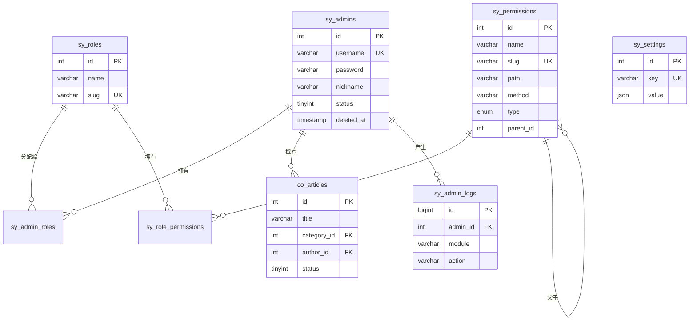

# 数据库设计

> 项目名称：**广告刷单系统**  
> 最后更新：2026-07-10  
> 表结构以 `app/model/*/XxxModel.php` 中的 `tableSchema()` 为唯一权威来源。

---

## 概述

| 项 | 说明 |
|----|------|
| 数据库 | MySQL 8.0+ |
| 字符集 | `utf8mb4` |
| 排序规则 | `utf8mb4_unicode_ci` |
| 存储引擎 | InnoDB |
| 表命名 | 模块前缀 + 下划线，见下表 |
| 结构同步 | `php webman model`（读取 Model `tableSchema()`） |
| 初始数据 | `php database/seed.php` |

详细命名与字段规范见 [MODEL_SCHEMA_STANDARD.md](./MODEL_SCHEMA_STANDARD.md)。

---

## 表名前缀

| 前缀 | 模块 | 模型目录 | 示例 |
|------|------|----------|------|
| `sy_` | 系统管理 | `app/model/sys/` | `sy_admins`, `sy_roles`, `sy_permissions`, `sy_settings` |
| `me_` | 会员 | `app/model/member/` | `me_user`, `me_user_water`, `me_user_card` |
| `ad_` | 广告位 | `app/model/ad/` | `ad_config`, `ad_product_order`, `ad_plan` |
| `pa_` | 支付 | `app/model/pay/` | `pa_recharge_order`, `pa_withdraw_order`, `pa_platform` |
| `iv_` | AI 托管 | `app/model/invest/` | `iv_product`, `iv_product_order`, `iv_speed_code` |
| `act_` | 活动 | `app/model/activity/` | `act_activity`, `act_recharge_bonus`, `act_turntable_log` |
| `sc_` | 服务中心 | `app/model/service/` | `sc_service_center`, `sc_service_center_application` |
| `co_` | 内容 | `app/model/content/` | `co_articles`, `co_banners`, `co_notices`, `co_video` |
| `toc_` | 运营中心 | `app/model/ops/` | `toc_operation_center`, `toc_operation_center_issue` |

会员交易分红等表亦在 `me_` 下，如 `me_trade_dividend_daily`。

---

## 系统模块 ER 关系（`sy_`）



---

## 核心业务表

### 系统（`sy_`）

| 表名 | 模型 | 说明 |
|------|------|------|
| `sy_admins` | `AdminModel` | 管理员 |
| `sy_roles` | `RoleModel` | 角色 |
| `sy_permissions` | `PermissionModel` | 权限（菜单/按钮/API） |
| `sy_admin_roles` | `AdminRoleModel` | 管理员-角色 |
| `sy_role_permissions` | `RolePermissionModel` | 角色-权限 |
| `sy_settings` | `SettingModel` | 系统键值配置（JSON） |
| `sy_admin_logs` | `AdminLogModel` | 操作日志 |
| `sy_dict_types` / `sy_dict_items` | `DictTypeModel` / `DictItemModel` | 数据字典 |
| `sy_lang` / `sy_lang_items` / `sy_lang_item_detail` | `LangModel` 等 | 多语言 |
| `sy_admin_notifications` | `AdminNotificationModel` | 后台通知 |
| `sy_admin_ip_whitelists` | `AdminIpWhitelistModel` | IP 白名单 |

### 会员（`me_`）

| 表名 | 模型 | 说明 |
|------|------|------|
| `me_user` | `UserModel` | 会员主表 |
| `me_user_water` | `UserWaterModel` | 资金流水 |
| `me_user_card` | `UserCardModel` | 银行卡/收款账号 |
| `me_user_message` | `UserMessageModel` | 站内信 |
| `me_user_real_name_auth` | `UserRealNameAuthModel` | 实名认证 |
| `me_user_credit_score` | `UserCreditScoreModel` | 信用分 |
| `me_user_brokerage_pool` | `UserBrokeragePoolModel` | 佣金池 |
| `me_user_ad_ratio_config` | `UserAdRatioConfigModel` | 广告位比例配置 |
| `me_user_ad_countdown_config` | `UserAdCountdownConfigModel` | 广告缓冲倒计时 |
| `me_trade_dividend_daily` | `TradeDividendDailyModel` | 每日交易分红 |

### 广告位（`ad_`）

| 表名 | 模型 | 说明 |
|------|------|------|
| `ad_config` | `AdConfigModel` | 广告位等级配置 |
| `ad_product_order` | `AdProductOrderModel` | 库存撮合订单 |
| `ad_plan` | `AdPlanModel` | 广告计划 |
| `ad_plan_days_config` | `AdPlanDaysConfigModel` | 计划日配置 |

`sy_settings` 中常见业务配置键：

| key | 说明 |
|-----|------|
| `finance_product_data` | 匹配成功弹窗文案 |
| `finance_product_overdue` | 超额匹配弹窗参数 |
| `finance_product_task_sessions` | 广告位开放时段 |
| `platform_scale_data` | 平台规模展示 |

### 支付（`pa_`）

| 表名 | 模型 | 说明 |
|------|------|------|
| `pa_platform` | `PayPlatformModel` | 支付/提现通道 |
| `pa_recharge_order` | `RechargeOrderModel` | 充值订单 |
| `pa_withdraw_order` | `WithdrawOrderModel` | 提现订单 |

### AI 托管（`iv_`）

| 表名 | 模型 | 说明 |
|------|------|------|
| `iv_product` | `InvestmentProductModel` | 托管产品 |
| `iv_product_order` | `InvestmentProductOrderModel` | 托管订单 |
| `iv_speed_code` | `InvestmentSpeedCodeModel` | 加速码 |

### 活动（`act_`）

| 表名 | 模型 | 说明 |
|------|------|------|
| `act_activity` | `ActivityModel` | 活动主表 |
| `act_activity_record` | `ActivityRecordModel` | 参与记录 |
| `act_recharge_bonus` | `ActivityRechargeBonusModel` | 充值送金阶梯 |
| `act_activity_password` | `ActivityPasswordModel` | 活动编码 |
| `act_invite_tier` | `ActivityInviteTierModel` | 邀请阶梯 |
| `act_turntable` / `act_turntable_log` | `TurntableModel` 等 | 转盘 |

### 内容（`co_`）

| 表名 | 模型 | 说明 |
|------|------|------|
| `co_articles` | `ArticleModel` | 文章 |
| `co_banners` | `BannerModel` | 轮播图 |
| `co_notices` | `NoticeModel` | 公告 |
| `co_video` | `VideoModel` | 视频 |
| `co_customer_services` | `CustomerServiceLinkModel` | 客服链接 |

---

## 时间字段约定

| 表类型 | `created_at` / `updated_at` | 示例 |
|--------|----------------------------|------|
| 后台实体表 | Laravel `timestamps`（datetime） | `sy_admins`, `me_user`, `co_articles` |
| 流水/日志表 | `unsignedBigInteger` unix，常仅 `created_at` | `me_user_water`, `me_user_log` |
| 广告/活动/托管订单 | unix 或 decimal 业务时间字段 | `ad_product_order`, `act_*`, `iv_*` |

新表设计请遵循 [MODEL_SCHEMA_STANDARD.md](./MODEL_SCHEMA_STANDARD.md) 第二节。

---

## 结构同步与迁移

### 推荐：模型驱动同步

```bash
# 同步全部 Model 表结构
php webman model

# 同步单个模型
php webman model AdProductOrderModel

# 生成模型存根
php webman model FooModel --make
```

等价 Composer 脚本：`composer migrate` → `php webman model`。

> 项目**不再使用** `php webman migrate:run` 或散落的一次性 SQL 补丁目录；表结构变更请修改 Model `tableSchema()` 后执行 `php webman model`。完整基线可参考 `doc/webman.sql`。

---

## 初始数据（Seeder）

```bash
php database/seed.php
# 或
composer seed
```

| 数据 | 说明 |
|------|------|
| 超级管理员 | `admin` / `admin123` |
| 默认角色 | `super_admin`, `editor` |
| 系统配置 | `sy_settings` 中的 `site_name` 等 |
| 权限菜单 | 执行 `php webman menu --fresh` 从控制器扫描同步 |

---

## 连接配置

数据库连接通过 `.env` 配置：

```env
DB_CONNECTION=mysql
DB_HOST=127.0.0.1
DB_PORT=3306
DB_DATABASE=webman_admin
DB_USERNAME=root
DB_PASSWORD=
```

完整环境变量见项目根目录 `.env.example`。

---

## 相关文档

| 文档 | 说明 |
|------|------|
| [MODEL_SCHEMA_STANDARD.md](./MODEL_SCHEMA_STANDARD.md) | 字段命名、全表清单、分区策略 |
| [FINANCE_TABLE_MAP.md](./FINANCE_TABLE_MAP.md) | 参考库 `qd_*` → 新表名映射 |
| [doc/开发文档.md](../doc/开发文档.md) | 开发环境与表前缀速查 |
| [doc/业务功能文档.md](../doc/业务功能文档.md) | 业务配置键说明 |

---

## 历史表名对照（迁移参考）

| 旧名（早期/参考库） | 现用表名 |
|---------------------|----------|
| `admins` | `sy_admins` |
| `roles` | `sy_roles` |
| `permissions` | `sy_permissions` |
| `admin_roles` | `sy_admin_roles` |
| `role_permissions` | `sy_role_permissions` |
| `settings` | `sy_settings` |
| `admin_logs` | `sy_admin_logs` |
| `articles` | `co_articles` |
| `qd_home_user` | `me_user` |
| `qd_recharge` | `pa_recharge_order` |
| `qd_withdrawals` | `pa_withdraw_order` |
| `qd_payment_platform` | `pa_platform` |
| `qd_money_log` | `me_user_water` |
